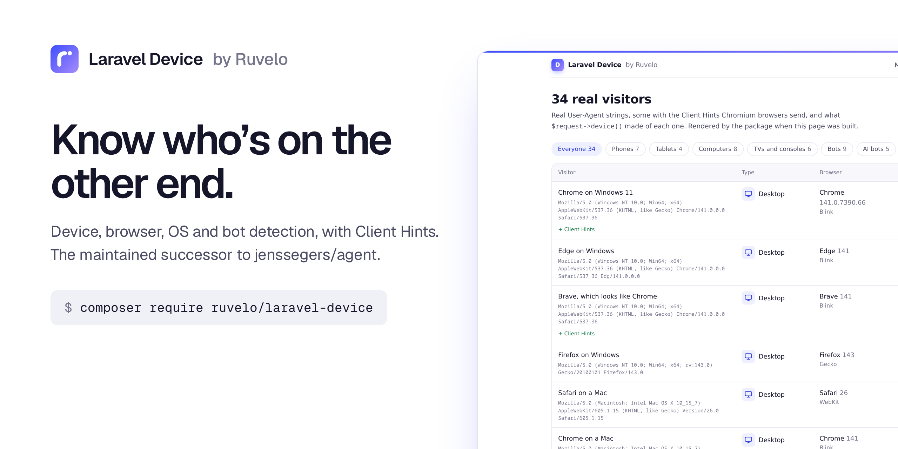
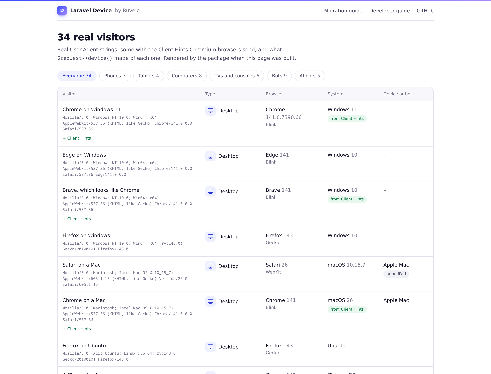
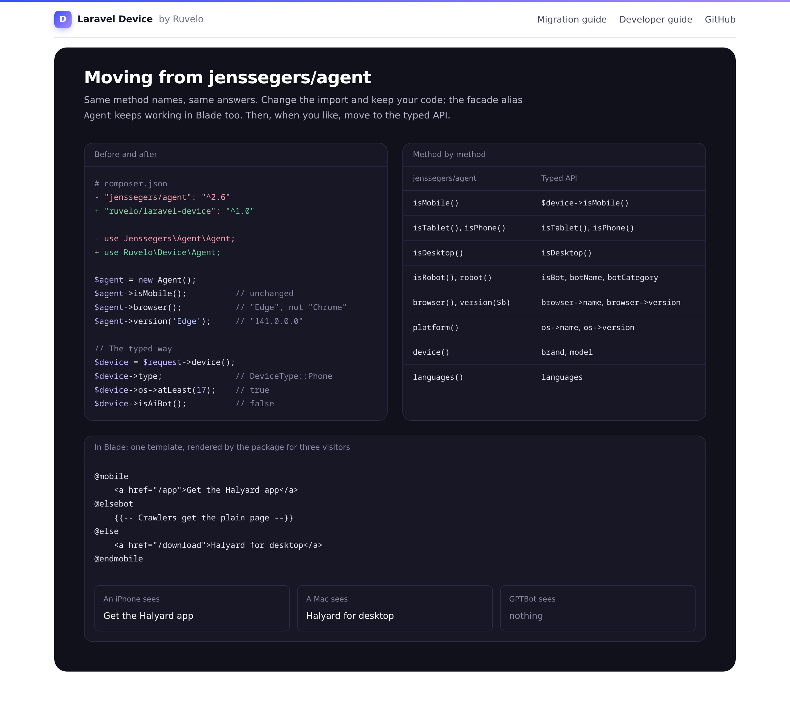
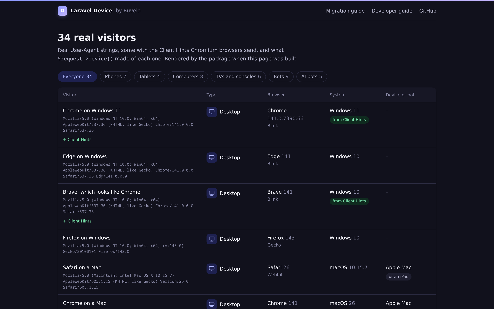
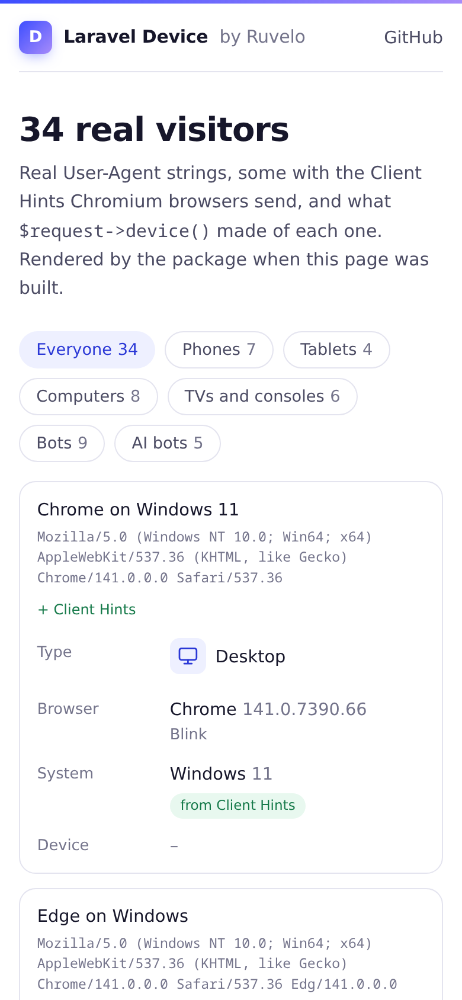

<p align="center">
  <a href="https://ruvelo.github.io/laravel-device/"></a>
</p>

<p align="center">
  <a href="https://ruvelo.github.io/laravel-device/"><strong>Live demo</strong></a> &nbsp;&nbsp;&nbsp;
  <a href="#configuration"><strong>Configuration</strong></a> &nbsp;&nbsp;&nbsp;
  <a href="#for-developers"><strong>Developer guide</strong></a> &nbsp;&nbsp;&nbsp;
  <a href="CHANGELOG.md"><strong>Changelog</strong></a>
</p>

<p align="center">
  <a href="https://github.com/Ruvelo/laravel-device/actions/workflows/tests.yml"></a>
  
  
  
  <a href="LICENSE"></a>
</p>

# Laravel Device

**Know who's on the other end.** Phones, tablets, TVs, consoles and watches; browsers, operating systems and engines; search engines, link previews and AI crawlers. It reads User-Agent Client Hints, so Windows 11, Brave and real Android models show up as they are.

It's the maintained successor to [jenssegers/agent](https://github.com/jenssegers/agent), which has had no release since June 2020. The `Agent` class keeps its method names and answers, so switching is a change of import.

```
composer require ruvelo/laravel-device
```

Then ask: `$request->device()`. Or see what it makes of 34 real visitors in the [live demo](https://ruvelo.github.io/laravel-device/) first.

## A quick tour



**One typed answer per visitor.** `$request->device()` gives you an immutable object: the device type as an enum, browser and system with versions, the engine, the maker and model when the browser tells, and what kind of bot it is, if it is one.

```php
$device = $request->device();

$device->type;               // DeviceType::Phone
$device->browser->name;      // "Samsung Internet"
$device->os->atLeast(15);    // true
$device->model;              // "SM-S938B"
$device->isAiBot();          // false
```



**Moving from jenssegers/agent is one line.** Same methods, same return values, its own test suite passing. Then move to the typed API at your own pace.

<table>
  <tr>
    <td width="50%"></td>
    <td width="50%"></td>
  </tr>
  <tr>
    <td>The demo is <strong>rendered by the package</strong> at build time, light and dark.</td>
    <td>It's also a quick way to check a User-Agent: <strong>every row is a real one.</strong></td>
  </tr>
</table>

## Features

- **Device types**: desktop, phone, tablet, TV, games console, wearable, bot or unknown, as a `DeviceType` enum. TVs and consoles are no longer "desktops".
- **Browsers**: Chrome, Edge, Firefox, Safari, Opera, Samsung Internet, Brave, Vivaldi, Yandex, DuckDuckGo, UC, Silk, Huawei, MIUI and others, plus in-app browsers (Instagram, Facebook, TikTok, WeChat) and Android web views. Edge and the other Chromium browsers are never mistaken for Chrome.
- **Operating systems**: Windows (10 vs 11 with Client Hints), macOS, iOS, iPadOS, Android, Fire OS, HarmonyOS, Chrome OS, Linux distributions, KaiOS, Tizen, webOS and more, with versions.
- **Engines**: Blink, WebKit, Gecko, EdgeHTML, Trident, Presto.
- **Maker and model** for Android phones and tablets, iPhones, iPads, Macs, TVs and consoles, when the User-Agent or Client Hints give it away.
- **Bots, sorted by what they're for**: search engines, AI training crawlers, AI search, AI assistants fetching for a person, link previews, SEO tools, monitors, feed readers, archivers and HTTP clients. GPTBot, ClaudeBot, PerplexityBot, Google-Extended, Bytespider, CCBot, Meta-ExternalAgent and friends included.
- **User-Agent Client Hints**: `Sec-CH-UA`, `-Mobile`, `-Platform`, `-Platform-Version`, `-Model`, `-Full-Version-List` and `-Form-Factors`, used when present, plus a middleware that asks browsers for them.
- **iPads that pretend to be Macs**: recognised when the browser gives it away, and flagged as "might be an iPad" when it doesn't. An optional one-line script settles it.
- **Blade directives**: `@mobile`, `@phone`, `@tablet`, `@desktop`, `@bot`, `@device('tv', 'console')`, each with its `@else` and `@unless` forms.
- **Fast**: about 50 µs to parse a new User-Agent, and each answer is remembered for the rest of the process (or in your cache store, if you like).
- **Small**: one runtime dependency, [Mobile Detect](https://github.com/serbanghita/Mobile-Detect), for the long tail of phones and tablets.
- **Drop-in for jenssegers/agent**: `Ruvelo\Device\Agent`, the `Agent` facade and alias, magic `isIphone()` methods and all.

## Requirements

- PHP 8.3+
- Laravel 12 or 13

## Moving from jenssegers/agent

```diff
- composer require jenssegers/agent
+ composer remove jenssegers/agent && composer require ruvelo/laravel-device
```

```diff
- use Jenssegers\Agent\Agent;
+ use Ruvelo\Device\Agent;

- use Jenssegers\Agent\Facades\Agent;
+ use Ruvelo\Device\Facades\Agent;
```

The package registers the `Agent` alias too, so `Agent::isMobile()` in Blade keeps working without changes. `app('agent')`, `new Agent()` and `new Agent($headers, $userAgent)` behave as before. jenssegers/agent's own test suite runs, unchanged, in [`tests/Unit/JenssegersCompatibilityTest.php`](tests/Unit/JenssegersCompatibilityTest.php).

| jenssegers/agent | Here | Typed API |
|---|---|---|
| `isMobile()` | Same (phones and tablets) | `$device->isMobile()` |
| `isTablet()`, `isPhone()` | Same | `$device->isTablet()`, `isPhone()` |
| `isDesktop()` | Same; false for TVs, consoles and watches | `$device->isDesktop()` |
| `isRobot()`, `robot()` | Same, with AI crawlers | `$device->isBot`, `botName`, `botCategory` |
| `browser()` | Same names ("Chrome", "IE", "Edge"...) plus new ones ("Samsung Internet", "Brave") | `$device->browser->name` |
| `platform()` | Same names ("Windows", "OS X", "AndroidOS", "iOS") | `$device->os->name` ("macOS", "Android", "iPadOS") |
| `version($name)` | Same; full browser version from Client Hints | `$device->browser->version`, `$device->os->version` |
| `device()` | Same (Mobile Detect's names: "iPhone", "Nexus", "Macintosh") | `$device->brand`, `$device->model` |
| `deviceType()` | Same ("desktop", "phone", "tablet", "robot", "other") | `$device->type` |
| `languages()` | Same | `$device->languages` |
| `is('Windows')`, `isIphone()` | Same | `$device->os->is('Windows')` |
| `match($regex)` | Same | |
| `setUserAgent()`, `setHttpHeaders()`, `getUserAgent()` | Same | `Device::fromUserAgent($ua, $headers)` |
| | `toDevice()` | the typed object for this agent |

What changed, on purpose:

- **Browser checks are exact.** `isChrome()` is false on Edge, Opera, Samsung Internet and Brave; `isSafari()` is false on Chrome. `browser()` names Samsung Internet, Yandex, DuckDuckGo and the in-app browsers instead of calling them Chrome or Safari.
- **iPads asking for desktop sites** are tablets when the browser gives it away (Chrome, Firefox and Edge for iPad say so), and with [`@detectIpad`](#ipads).
- **TVs, consoles and watches** are no longer desktops. `deviceType()` calls them "other".
- **Robots** come from this package's own list instead of [jaybizzle/crawler-detect](https://github.com/JayBizzle/Crawler-Detect). It's shorter but current, and sorted into categories; anything calling itself a bot, crawler or spider is still caught. If you depended on an obscure crawler being named, check `robot()` for it.
- **Client Hints** are read when the browser sends them.
- **One Agent per request**, so it's safe under Octane.

## Configuration

Everything works without configuration. To change the defaults:

```
php artisan vendor:publish --tag=device-config
```

| Key | Default | |
|---|---|---|
| `client_hints.read` | `true` (`DEVICE_CLIENT_HINTS`) | Use `Sec-CH-UA-*` headers when the browser sends them |
| `client_hints.request` | platform version, model, full version list, form factors | What the `device.hints` middleware asks for |
| `client_hints.critical` | `[]` | Hints to also send as `Critical-CH`: the browser retries the first request with them |
| `cache.store` | `null` (`DEVICE_CACHE_STORE`) | A cache store to share answers between requests; memory only when null |
| `cache.ttl` | one week | How long cached answers live |
| `ipad_cookie` | `device_ipad` | The cookie `@detectIpad` sets; `null` turns it off |
| `max_length` | `1000` | Longer User-Agents are cut before parsing |
| `blade_directives` | `true` | Register `@mobile` and friends |
| `request_macro` | `true` | Register `$request->device()` |

## Client Hints

Chromium browsers (Chrome, Edge, Opera, Samsung Internet, Brave...) have frozen their User-Agent: every Windows is "Windows NT 10.0", every Mac "10_15_7", every Android phone "Android 10; K", and the browser version ends in ".0.0.0". The real details moved to `Sec-CH-UA-*` request headers.

Three of them arrive on every HTTPS request, and the package uses them as soon as they're there: the brand (so Brave and Opera are recognised), whether the device is mobile, and the platform. For the rest, ask with the `device.hints` middleware:

```php
// bootstrap/app.php
->withMiddleware(function (Middleware $middleware) {
    $middleware->web(append: \Ruvelo\Device\Http\Middleware\RequestClientHints::class);
})
```

or per route with `->middleware('device.hints')`. It sends `Accept-CH`, and browsers include the hints from the next request on: Windows 10 vs 11, the macOS and Android version, the phone model, the full browser version and the form factor. Pass hints to the alias to pick your own: `device.hints:Sec-CH-UA-Model`.

Good to know:

- Browsers only send hints over HTTPS (and to `localhost`).
- The first request of a visit only has the three basic hints. List a hint in `client_hints.critical` to have the browser retry that first request with it; that costs a round trip, once.
- Safari and Firefox don't send Client Hints. For them the User-Agent is still the source, and it hasn't been frozen the same way, except where noted below.
- If a CDN caches pages that differ by device, add the hints you rely on to the `Vary` header.

## iPads

Since iPadOS 13, Safari on an iPad asks for desktop sites with exactly the same User-Agent as Safari on a Mac. No server-side library can tell them apart from the request alone. This package:

- recognises iPads whenever the browser gives it away: Chrome, Firefox, Edge and Opera for iPad keep their iOS names (`CriOS`, `FxiOS`...) in the Mac User-Agent;
- otherwise reports a desktop Mac, with `$device->mightBeIpad` set to `true` for Safari, so you can hedge;
- offers `@detectIpad`, a one-line inline script for your layout's `<head>`. On a "Mac" with a touch screen (Macs have none) it sets a `device_ipad` cookie, and from the next request on the visitor is an iPad running iPadOS, with the version taken from Safari's own version number. The cookie is excluded from Laravel's cookie encryption automatically. The script uses Vite's CSP nonce when you've set one.

The very first page view of an iPad in desktop mode is still a Mac. That's a limit of the web platform, not something a parser can fix.

Two more frozen values: since iOS 26, Safari's User-Agent says iOS 18.6 whatever the real version; the package reads the version from Safari's `Version/26.0` instead. Macs always say 10.15.7 without Client Hints.

## Bots

```php
$device->isBot;          // true
$device->botName;        // "ClaudeBot"
$device->botCategory;    // BotCategory::AiCrawler
$device->isAiBot();      // true for AiCrawler, AiSearch and AiAssistant
```

| Category | Who |
|---|---|
| `Search` | Googlebot, Bingbot, DuckDuckBot, Applebot, YandexBot, Baiduspider, PetalBot... |
| `AiCrawler` | GPTBot, ClaudeBot, CCBot, Bytespider, Google-Extended, Applebot-Extended, Meta-ExternalAgent, Amazonbot, cohere-ai, Diffbot... |
| `AiSearch` | OAI-SearchBot, Claude-SearchBot, PerplexityBot, YouBot... |
| `AiAssistant` | ChatGPT-User, Claude-User, Perplexity-User, MistralAI-User, DuckAssistBot: one page, fetched because a person asked |
| `Social` | facebookexternalhit, Twitterbot, LinkedInBot, Slackbot, Discordbot, WhatsApp, Mastodon... |
| `Seo`, `Monitoring`, `Feed`, `Archiver` | AhrefsBot, SemrushBot; UptimeRobot, Pingdom, Lighthouse; Feedly; the Internet Archive... |
| `Tool` | curl, Wget, python-requests, Go-http-client, Guzzle, Postman, HeadlessChrome... |
| `Other` | anything else that calls itself a bot, crawler or spider |

A User-Agent is only a claim: anyone can send "Googlebot". If you grant crawlers anything, verify them by reverse DNS or the operator's published IP ranges. Google-Extended and Applebot-Extended are robots.txt names; their owners crawl as Googlebot and Applebot, so expect them only from impostors.

## Blade

```blade
@mobile
    <a href="/app">Get the app</a>
@elsebot
    {{-- crawlers get the plain page --}}
@else
    <a href="/download">Download for desktop</a>
@endmobile

@device('tv', 'console') <p>Use your remote: arrows and OK.</p> @enddevice
```

`@mobile` means phones and tablets, as in jenssegers/agent; use `@phone` for phones only. Every directive has `@else…`, `@unless…` and `@end…` forms. To use `$device` in every view, add the `device.share` middleware (`device.share:visitor` names the variable `$visitor`).

## For developers

### PHP API

```php
use Ruvelo\Device\Device;
use Ruvelo\Device\DeviceType;

$device = $request->device();                      // the request macro
$device = Device::fromRequest();                   // the current request
$device = Device::fromUserAgent($ua);              // any string, e.g. from your logs
$device = Device::fromUserAgent($ua, $headers);    // with Sec-CH-UA-*, Accept-Language... in any common shape

$device->is('mobile');                             // phones and tablets
$device->is(DeviceType::Tv, 'console');            // any of these
$device->browser->is('firefox');                   // case-insensitive name check
$device->browser->major();                         // 143
(string) $device->os;                              // "Windows 11"
$device->language();                               // "fr-be"
$device->toArray();                                // see below
```

| Property | Type | |
|---|---|---|
| `type` | `DeviceType` | `Desktop`, `Phone`, `Tablet`, `Tv`, `Console`, `Wearable`, `Bot`, `Unknown` |
| `browser`, `os`, `engine` | `Browser`, `OperatingSystem`, `Engine` | Each with `name` and `version` (strings or null), `major()`, `atLeast()`, `is()`, `known()` |
| `brand`, `model` | `?string` | "Apple"/"iPhone", "Samsung"/"SM-S938B", "Sony"/"PlayStation 5" |
| `isBot`, `botName`, `botCategory` | `bool`, `?string`, `?BotCategory` | |
| `languages` | `list<string>` | From Accept-Language, most preferred first, lowercased |
| `usedClientHints` | `bool` | Whether Client Hints changed the answer |
| `mightBeIpad` | `bool` | Safari on a Mac, which might be an iPad in desktop mode |
| `userAgent` | `string` | What was parsed |

### JSON

`Device` is `JsonSerializable`, so `return $request->device();` or `response()->json($device)` gives React, Vue and Inertia apps the same answer:

```json
{
    "type": "phone",
    "browser": { "name": "Samsung Internet", "version": "28.0" },
    "os": { "name": "Android", "version": "15" },
    "engine": { "name": "Blink", "version": "130.0.0.0" },
    "brand": "Samsung",
    "model": "SM-S938B",
    "is_bot": false,
    "bot": null,
    "languages": ["en-gb"],
    "used_client_hints": false,
    "might_be_ipad": false,
    "user_agent": "Mozilla/5.0 (Linux; Android 15; SM-S938B) ..."
}
```

For bots, `bot` is `{"name": "GPTBot", "category": "ai-crawler"}`. `Device::fromArray()` reads it back.

### Middleware

| Alias | Class | Does |
|---|---|---|
| `device.share` | `Http\Middleware\ShareDevice` | Shares `$device` (or the name you pass) with every view |
| `device.hints` | `Http\Middleware\RequestClientHints` | Sends `Accept-CH` (and `Critical-CH`) to ask for Client Hints |

### Events and exceptions

Detection changes nothing, so there are no events. Exceptions implement `Ruvelo\Device\Exceptions\DeviceException`: `InvalidDeviceType` (an unknown name passed to `is()` or `@device`) and `UnknownMethod` (a magic method on `Agent` that doesn't start with "is"; still a `BadMethodCallException`, as before).

### In your tests

`Ruvelo\Device\Testing\UserAgents` holds real, current User-Agents, so you don't have to collect them:

```php
use Ruvelo\Device\Testing\UserAgents;

$this->withHeader('User-Agent', UserAgents::IPHONE)->get('/')->assertSee('Get the app');
$this->withHeader('User-Agent', UserAgents::GPTBOT)->get('/articles/1')->assertForbidden();
```

### How detection works

The package keeps its own rule tables, in [`src/Detection`](src/Detection), ordered from most to least specific: bots, browsers, operating systems, then TVs, consoles, wearables and Android makers. Client Hints override the User-Agent where they're more reliable. [Mobile Detect](https://github.com/serbanghita/Mobile-Detect) (MIT, maintained) answers only what those tables don't recognise, the long tail of phones and tablets, and provides the device names behind `Agent::device()` and the magic `isNexus()`-style methods. It has no dependencies of its own beyond PSR-16, which Laravel already ships.

Each answer is kept in memory for the life of the process, up to 500 User-Agents, so long-running workers don't grow. Set `cache.store` to share answers between processes; entries are keyed by the rules' version, so an update never serves stale answers.

Found a User-Agent it gets wrong? [Open an issue](https://github.com/Ruvelo/laravel-device/issues) with the string (and the `Sec-CH-UA-*` headers, if any), or add it to [`tests/Fixtures/user-agents.php`](tests/Fixtures/user-agents.php) in a pull request.

### Laravel Boost

If your app uses [Laravel Boost](https://laravel.com/docs/boost), `php artisan boost:install` picks up this package's guidelines, so your coding agent uses `$request->device()` instead of hand-written User-Agent regexes, branches on bot categories rather than names, and uses the test User-Agents.

## Contributing

Pull requests are welcome, and new User-Agents most of all. Clone, `composer install`, then `composer check` runs code style (Pint), static analysis (PHPStan level 8) and the tests, exactly as CI does. See [CONTRIBUTING.md](CONTRIBUTING.md) and the [changelog](CHANGELOG.md).

The demo and screenshots are built from the package itself: `composer demo` writes the static demo into `build/`, and `demo/screenshots.sh` regenerates `art/`.

## Credits

Built by [François Bultez](https://github.com/francoisbultez) at [Ruvelo](https://github.com/Ruvelo), and everyone who [contributes](https://github.com/Ruvelo/laravel-device/graphs/contributors).

Thanks to [Jens Segers](https://github.com/jenssegers) for [jenssegers/agent](https://github.com/jenssegers/agent), which served the Laravel community for a decade and whose API the `Agent` class keeps, and to [Şerban Ghiţă](https://github.com/serbanghita) and the contributors of [Mobile Detect](https://github.com/serbanghita/Mobile-Detect).

## License

MIT. See [LICENSE](LICENSE).
